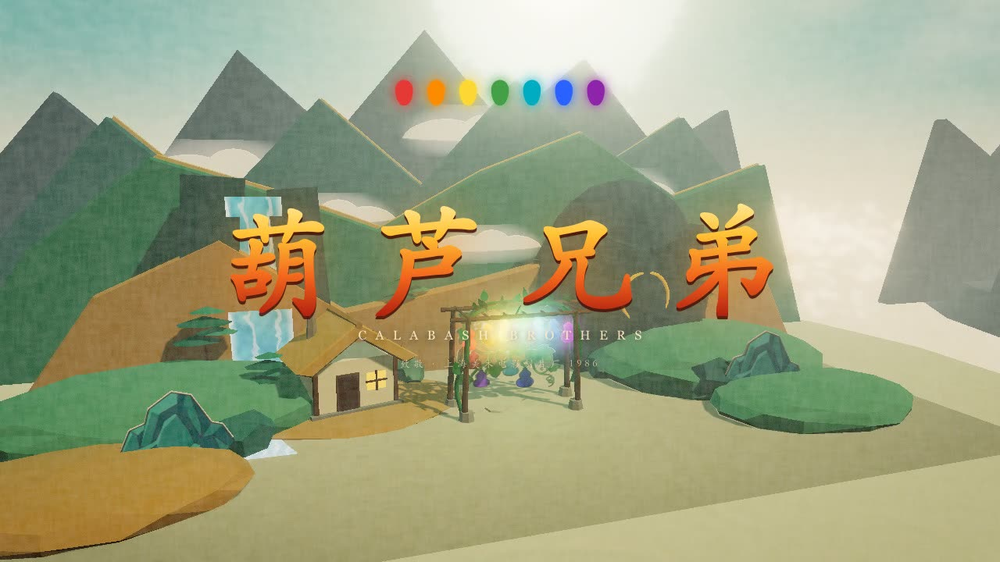
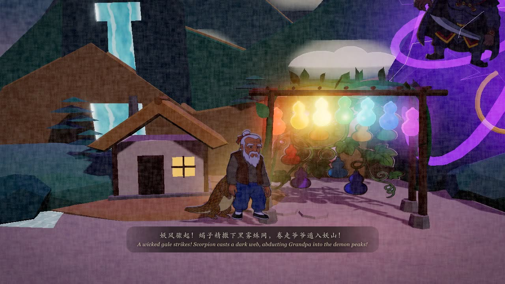
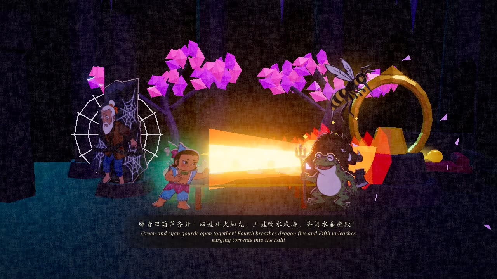
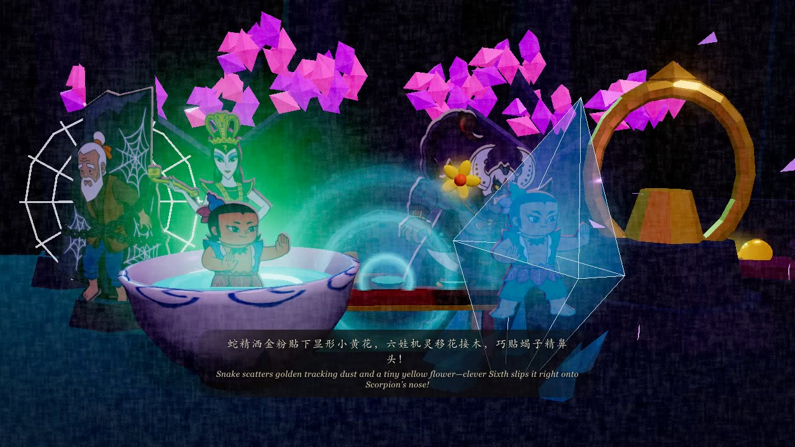
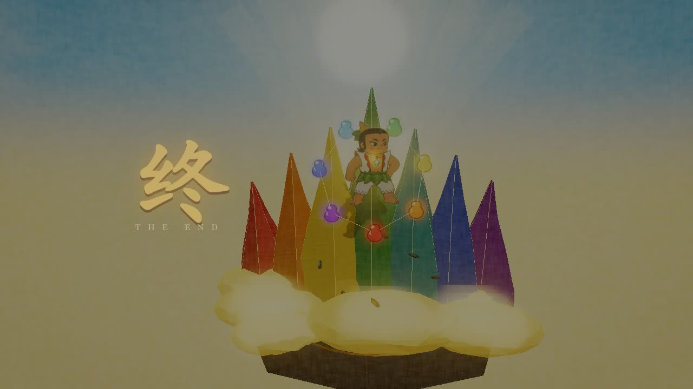

# 葫芦兄弟 · 立体宣纸皮影剧场 / Calabash Brothers 3D

用 Three.js 在浏览器里**实时渲染**的《葫芦兄弟》3D 致敬短片：片头 + 九幕正片 + 片尾，共 4 分 52 秒。
这不是视频生成模型的产物，每一帧都是代码算出来的，代码由 AI agent 编写。

A 3D tribute to the 1986 Chinese animated classic *Calabash Brothers*, rendered **live in the browser** with Three.js.
No video model involved: every frame is computed in real time, and the code was written by AI agents.



| | |
|---|---|
|  |  |
|  |  |

## 内容 / What's inside

- **美术风格**：全三维 `.glb` 角色与法宝道具（1:1 还原 86 版角色神态与纹样细节，支持实时三维顶点姿态形变）+ 青绿山水 3D 舞台（原 2D 贴图亦完整保留于 `assets/Sprites_*`）。
- **七兄弟的本领和中计都按原片复刻**：大娃陷迷魂泥潭、二娃被魔镜刺伤双目、三娃被刚柔阴阳剑缠住、四娃被冰封、五娃醉倒、六娃把显形小黄花贴到蝎子精鼻子上、七娃被妖精养大后吸走六位哥哥。
- **四个 3D 场景**：葫芦山、迷魂谷、水晶魔殿、炼丹深渊与七色神峰。
- **主题曲**：原旋律的国风器乐改编，片头播放，片尾升调再现。
- **中英双语字幕**，九幕章节可一键跳转。

## 重制版 / Remaster

全片保留原九幕剧情和配乐旋律。重做镜位、走位与动作反应；现有器乐与音效重混为一份 4:52 母带，供网页和 MP4 共用。这里不包含 1986 年档案人声或新增配音。

## 运行 / Run

需要一个静态文件服务器（直接双击 `index.html` 会因 ES Module 跨域限制而无法加载）：

```bash
git clone -b dev/huluwa-film-remaster https://github.com/litany-lty/huluwa-3d.git
cd huluwa-3d
python3 tools/build_audio.py  # 已有交付包内的 exports/film_audio.wav 时可跳过
python3 -m http.server 8765 --bind 127.0.0.1
# 观看短片：打开 http://127.0.0.1:8765/
# 360° 检视全部 48 项 3D 模型与原画对比：打开 http://127.0.0.1:8765/gallery.html
```

无需 npm install，three.js r170 已放在 `vendor/`。构建音轨用现有 WAV，需要 Node、FFmpeg 和 Python 3 + NumPy。网页默认播放 `exports/film_audio.wav`；如果尚未生成母带，`?audio=legacy` 可以听旧混音作对照。

**快捷键**：`Space` 播放/暂停 · `←/→` 快退/快进 5 秒 · `1`–`9` 跳到第几幕 · `C` 导演镜头/自由环视 · `M` 静音

**URL 参数**：`?t=120` 跳到正片第 120 秒 · `?autostart=1` 自动播放 · `?paused=1` 跳过开幕页并停在指定时间

## 导出视频 / Export MP4

逐帧离线渲染，画面与音轨都是确定性生成的，不依赖实时播放的帧率。需要 Google Chrome、ffmpeg、Python 3 + numpy。

```bash
python3 tools/build_audio.py  # 生成整片母带 film_audio.wav 和音乐独立轨 film_music.wav
python3 -m http.server 8765 --bind 127.0.0.1 &
node tools/render_film.mjs --out exports/film.mp4 --fps 24 --w 1280 --h 720
```

Chrome 不在默认路径时，设置 `CHROME_PATH` 环境变量。1080p 改用 `--w 1920 --h 1080`。局部导出可使用 `--from 起秒 --to 止秒`，两者都是从片头起算的全片时间。交付用母带及视频不纳入源码提交。

## 代码结构 / Structure

```
src/
  core/       素材注册、宣纸材质、后期管线、音频调度
  worlds/     四个 3D 场景与天空/灯光/雾气情绪预设
  actors/     多层皮影角色（顶点形变姿态）与角色清单
  effects/    七兄弟本领与陷阱特效
  director/   分镜/字幕/音效时间轴数据，与逐帧编排的导演器
  main.js     片头、正片、片尾总时间轴与播放器 UI
tools/        离线渲染与混音导出脚本
assets/       角色、道具、场景、特效贴图与音乐音效
```

## 版权声明 / Disclaimer

本项目是**非商业**的粉丝致敬作品，献给上海美术电影制片厂 1986 年出品的《葫芦兄弟》。
原作角色、造型与主题曲的权利归原权利方所有。

- `src/`、`tools/`、`index.html`、`gallery.html`、`style.css` 的代码以 **MIT** 协议开源。
- `assets/` 中的 2D/3D 与音频素材是基于原作的二次创作，**不在 MIT 协议范围内**（见 [NOTICE](NOTICE)），仅供学习和非商业用途。如权利方认为不妥，请提 issue 联系，我会及时处理。

This is a non-commercial fan tribute. Code is MIT licensed; files in `assets/` are fan-made derivatives of the original work and are not covered by the MIT license.

## 3D 素材精修

[48 件模型前后图、逐项改动与验收记录](docs/model-polish/README.md)。
